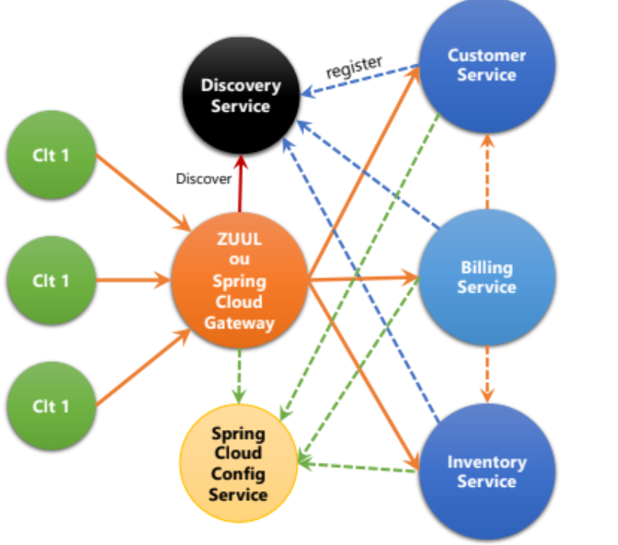

#  Activité Pratique N°2 — Architecture Micro-services avec Spring Cloud

Application e-commerce de démonstration construite avec une **architecture micro-services** : chaque domaine métier (clients, produits, facturation) est un service indépendant, enregistré dans un annuaire **Eureka** et exposé via une **API Gateway**.

> Projet réalisé dans le cadre de la formation à l'ENSET — Spring Boot 4 · Spring Cloud 2025.1 · Java 21.

---

## 📑 Table des matières

1. [Objectifs pédagogiques](#-objectifs-pédagogiques)
2. [Architecture](#-architecture)
3. [Technologies utilisées](#-technologies-utilisées)
4. [Structure du projet](#-structure-du-projet)
5. [Description des services](#-description-des-services)
6. [Prérequis](#-prérequis)
7. [Installation et lancement](#-installation-et-lancement)
8. [Endpoints et exemples d'utilisation](#-endpoints-et-exemples-dutilisation)
9. [Résilience : Circuit Breaker](#-résilience--circuit-breaker)
10. [Console H2](#-console-h2)
11. [Points d'attention et améliorations](#-points-dattention-et-améliorations)
12. [Auteur](#-auteur)

---

## 🎯 Objectifs pédagogiques

- Comprendre et mettre en place une architecture micro-services.
- Utiliser **Eureka** comme service de découverte (*Service Discovery*).
- Exposer les services via **Spring Cloud Gateway** (routage dynamique).
- Exposer rapidement des API REST avec **Spring Data REST**.
- Faire communiquer des services entre eux avec **OpenFeign**.
- Tolérer les pannes avec **Resilience4j** (*Circuit Breaker* + *fallback*).
- Séparer les données : **une base H2 par micro-service** (*database per service*).

---

## 🏗 Architecture



*Schéma d'architecture de l'application micro-services.*

**Principe de fonctionnement :**

1. Chaque service démarre et s'enregistre auprès d'**Eureka** (`discovery-service`).
2. La **Gateway** interroge Eureka pour connaître les services disponibles et crée les routes automatiquement.
3. Le **billing-service** appelle `customer-service` et `inventory-service` via **OpenFeign**, en utilisant uniquement leur *nom logique* (pas d'adresse IP/port en dur) grâce à Eureka.
4. Le `billing-service` ne stocke que les **identifiants** (`customerId`, `productId`) ; les détails sont récupérés à la volée auprès des autres services.

---

## 🧰 Technologies utilisées

| Catégorie | Technologie | Version |
|---|---|---|
| Langage | Java | 21 (17 minimum pour customer/inventory) |
| Framework | Spring Boot | 4.1.1 |
| Cloud | Spring Cloud (release train) | 2025.1.3 |
| Découverte | Spring Cloud Netflix Eureka (Server + Client) | — |
| Gateway | Spring Cloud Gateway (WebFlux) | — |
| Communication | Spring Cloud OpenFeign | — |
| Résilience | Resilience4j (Circuit Breaker) | — |
| Persistance | Spring Data JPA + H2 (en mémoire) | — |
| API REST | Spring Data REST + Spring Web MVC | — |
| Monitoring | Spring Boot Actuator | — |
| Utilitaires | Lombok, Maven Wrapper | — |

---

## 📂 Structure du projet

```
Activit-Pratique-N-2--Architecture-Micro-services-avec-Spring-cloud/
├── pom.xml                      # POM racine (ecom-ms-app)
├── discovery-service/           # Serveur Eureka                  (port 8761)
├── gateway-service/             # API Gateway                     (port 8888)
├── customer-service/            # Gestion des clients             (port 8081)
├── inventory-service/           # Gestion des produits / stock    (port 8082)
└── billing-service/             # Gestion des factures            (port 8083)
```

Chaque module est un projet Spring Boot **autonome** avec son propre `pom.xml` et son propre Maven Wrapper (`mvnw` / `mvnw.cmd`).

---

## 🧩 Description des services

### 1. `discovery-service` — Serveur Eureka (port `8761`)
- Annoté `@EnableEurekaServer`.
- Annuaire de tous les services. Il ne s'enregistre pas lui-même (`register-with-eureka=false`, `fetch-registry=false`).
- Tableau de bord : <http://localhost:8761>

### 2. `gateway-service` — API Gateway (port `8888`)
- Point d'entrée unique de l'application.
- Utilise un bean `DiscoveryClientRouteDefinitionLocator` : les routes sont **créées dynamiquement** à partir des services enregistrés dans Eureka.
- Format d'URL : `http://localhost:8888/<NOM-DU-SERVICE-EN-MAJUSCULES>/<chemin>`

### 3. `customer-service` — Clients (port `8081`)
- Entité **`Customer`** : `id`, `name`, `email`.
- Repository exposé automatiquement en REST via `@RepositoryRestResource`.
- Données de test insérées au démarrage (`CommandLineRunner`) :

| id | name | email |
|---|---|---|
| 1 | Fahd | fahd@gmail.com |
| 2 | Imane | imane@gmail.com |
| 3 | Yassine | yassine@gmail.com |

- Base : `jdbc:h2:mem:customers-db`

### 4. `inventory-service` — Produits (port `8082`)
- Entité **`product`** : `id`, `name`, `price`, `quantity`.
- Repository exposé en REST via `@RepositoryRestResource`.
- Données de test insérées au démarrage :

| id | name | price | quantity |
|---|---|---|---|
| 1 | Computer | 34000 | 12 |
| 2 | Printer | 1200 | 11 |
| 3 | smartphone | 1300 | 10 |

- Base : `jdbc:h2:mem:products-db`

### 5. `billing-service` — Facturation (port `8083`)
- Entités JPA :
  - **`Bill`** : `id`, `billingDate`, `customerId`, liste de `ProductItem`, et un `Customer` **transitoire** (`@Transient`, non persisté).
  - **`ProductItem`** : `id`, `productId`, `quantity`, `price`, lien `@ManyToOne` vers `Bill`, et un `Product` **transitoire**.
- Clients **OpenFeign** :
  - `CustomerServiceRestClient` → `customer-service` (`GET /customers/{id}`), protégé par un **Circuit Breaker**.
  - `InventoryservicerestClient` → `inventory-service` (`GET /products/{id}`).
- Contrôleur `BillRestController` : `GET /bills/{id}` retourne la facture **enrichie** avec les infos du client et des produits.
- Base : `jdbc:h2:mem:billing-db`

---

## ✅ Prérequis

- **JDK 21** (recommandé : un seul JDK 21 couvre tous les modules)
- **Maven 3.9+** (ou utiliser le Maven Wrapper `./mvnw` fourni)
- Un IDE avec le plugin **Lombok** activé (IntelliJ IDEA recommandé) + *Annotation Processing* activé
- (Optionnel) **Postman** ou `curl` pour tester les API

---

## 🚀 Installation et lancement

### 1. Cloner le dépôt

```bash
git clone <url-du-depot>
cd Activit-Pratique-N-2--Architecture-Micro-services-avec-Spring-cloud-main
```

### 2. Lancer les services **dans cet ordre**

> ⚠️ L'ordre est important : Eureka doit être démarré en premier.

| Ordre | Service | Commande |
|:-:|---|---|
| 1 | discovery-service | `cd discovery-service && ./mvnw spring-boot:run` |
| 2 | customer-service | `cd customer-service && ./mvnw spring-boot:run` |
| 3 | inventory-service | `cd inventory-service && ./mvnw spring-boot:run` |
| 4 | billing-service | `cd billing-service && ./mvnw spring-boot:run` |
| 5 | gateway-service | `cd gateway-service && ./mvnw spring-boot:run` |

*(Sous Windows : remplacer `./mvnw` par `mvnw.cmd`.)*

Chaque commande se lance dans **un terminal distinct** (ou via les configurations *Run* de l'IDE).

### 3. Vérifier

Ouvrir le dashboard Eureka : <http://localhost:8761>
Les 4 services suivants doivent apparaître avec le statut **UP** :
`CUSTOMER-SERVICE`, `INVENTORY-SERVICE`, `BILLING-SERVICE`, `GATEWAY-SERVICE`.

### Tableau récapitulatif des ports

| Service | Port | URL |
|---|:-:|---|
| Eureka (discovery) | 8761 | http://localhost:8761 |
| Customer | 8081 | http://localhost:8081 |
| Inventory | 8082 | http://localhost:8082 |
| Billing | 8083 | http://localhost:8083 |
| Gateway | 8888 | http://localhost:8888 |

---

## 🔌 Endpoints et exemples d'utilisation

### Accès direct aux services

| Service | Méthode | Endpoint | Description |
|---|---|---|---|
| customer | GET | `/customers` | Liste des clients |
| customer | GET | `/customers/{id}` | Un client |
| customer | POST / PUT / DELETE | `/customers[/{id}]` | CRUD complet (Spring Data REST) |
| inventory | GET | `/products` | Liste des produits |
| inventory | GET | `/products/{id}` | Un produit |
| inventory | POST / PUT / DELETE | `/products[/{id}]` | CRUD complet |
| billing | GET | `/bills/{id}` | Facture **enrichie** (client + produits) |
| billing | GET / POST | `/bills`, `/productItems` | CRUD Spring Data REST |

### Accès via la Gateway (routage dynamique)

```text
http://localhost:8888/CUSTOMER-SERVICE/customers
http://localhost:8888/CUSTOMER-SERVICE/customers/1
http://localhost:8888/INVENTORY-SERVICE/products
http://localhost:8888/INVENTORY-SERVICE/products/2
http://localhost:8888/BILLING-SERVICE/bills/1
```

### Scénario complet de test

**1. Lister les clients et les produits**
```bash
curl http://localhost:8081/customers
curl http://localhost:8082/products
```

**2. Créer une facture** pour le client `1`
```bash
curl -X POST http://localhost:8083/bills \
  -H "Content-Type: application/json" \
  -d '{"billingDate":"2026-01-15T10:00:00.000+00:00","customerId":1}'
```

**3. Ajouter des lignes de produit** à cette facture (remplacer `1` par l'id de la facture créée)
```bash
curl -X POST http://localhost:8083/productItems \
  -H "Content-Type: application/json" \
  -d '{"productId":1,"quantity":2,"price":34000,"bill":"http://localhost:8083/bills/1"}'

curl -X POST http://localhost:8083/productItems \
  -H "Content-Type: application/json" \
  -d '{"productId":2,"quantity":1,"price":1200,"bill":"http://localhost:8083/bills/1"}'
```

**4. Consulter la facture enrichie**
```bash
curl http://localhost:8083/bills/1
```

Exemple de réponse attendue :
```json
{
  "id": 1,
  "billingDate": "2026-01-15T10:00:00.000+00:00",
  "customerId": 1,
  "customer": { "id": "1", "name": "Fahd", "email": "fahd@gmail.com" },
  "productItems": [
    {
      "id": 1, "productId": 1, "quantity": 2, "price": 34000.0,
      "product": { "id": 1, "name": "Computer", "price": 34000.0, "quantity": 12 }
    },
    {
      "id": 2, "productId": 2, "quantity": 1, "price": 1200.0,
      "product": { "id": 2, "name": "Printer", "price": 1200.0, "quantity": 11 }
    }
  ]
}
```

> 💡 Les bases H2 étant **en mémoire**, la facture doit être recréée à chaque redémarrage de `billing-service` (aucune donnée de test n'y est insérée automatiquement).

---

## 🛡 Résilience : Circuit Breaker

Le client Feign `CustomerServiceRestClient` est annoté avec `@CircuitBreaker` (Resilience4j) et dispose d'une méthode de **fallback** `getDefaultCustomer`, qui renvoie un client par défaut :

```json
{ "id": "...", "name": "default customer name", "email": "default@gmail.com" }
```

**Test suggéré :** arrêter `customer-service`, puis appeler `GET /bills/1` : la facture doit toujours être retournée, avec le client par défaut au lieu d'une erreur 500.

---

## 🗄 Console H2

Chaque service avec persistance expose la console H2 (`spring.h2.console.enabled=true`) :

| Service | URL console | JDBC URL |
|---|---|---|
| customer-service | http://localhost:8081/h2-console | `jdbc:h2:mem:customers-db` |
| inventory-service | http://localhost:8082/h2-console | `jdbc:h2:mem:products-db` |
| billing-service | http://localhost:8083/h2-console | `jdbc:h2:mem:billing-db` |

---

## 👤 Auteur

**Fahd Krachel** — Étudiant à l'ENSET
Projet pédagogique — *Activité Pratique N°2 : Architecture Micro-services avec Spring Cloud*.
